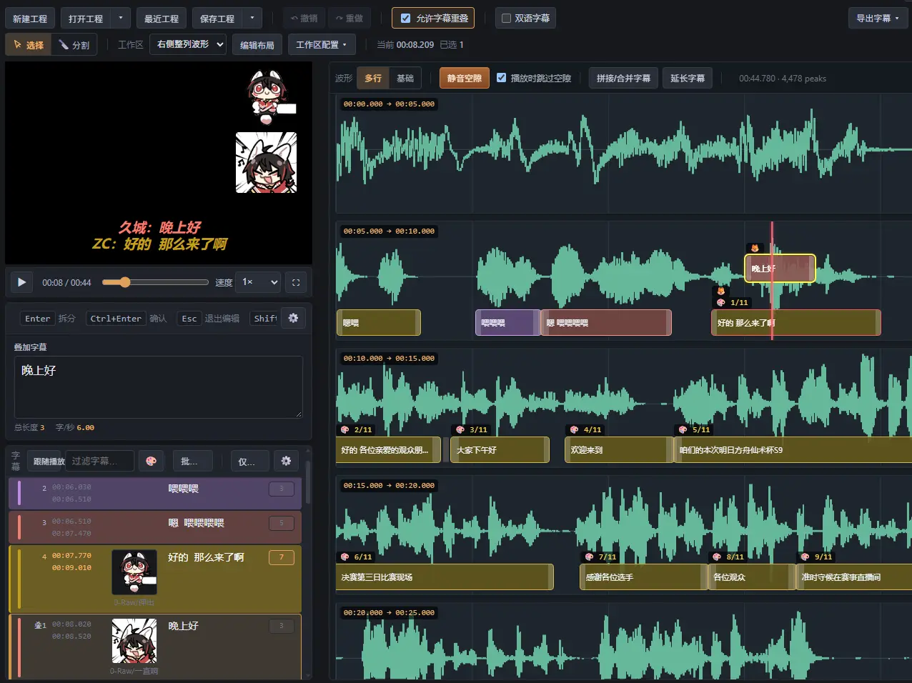

# Moy's ASR Workflow (MAW)

> Local media → ASR → SRT + `.mosp` project → MAWE editor → export.

MAW connects subtitle generation with review, cleanup, and delivery. It provides a graphical Launcher, a public CLI, and the local MAWE browser editor, with cloud ASR as the main transcription path. It is suited to subtitle-heavy recordings such as presentations, interviews, and courses.

Use a script to assist proofreading, try reversible pause removal, edit multiple subtitle tracks, and hand the result to other tools. Keep the `.mosp` project so the next revision can continue from your existing work.

*Editor example from 1.6.0: review text and video on the left, adjust timing against the waveform on the right. Workspace layouts are configurable.*

Latest beta: [v1.9.0-beta.1](https://github.com/Moyf/moys-asr-workflow/releases/tag/v1.9.0-beta.1).

## Why MAW

- **Connect text with sound:** retain the word or character timing supplied by your ASR provider, then navigate, split, and adjust boundaries on a multi-row waveform. Segment-only timing still needs listening and is not word-level precision.
- **Put your script to work:** local script matching corrects text without an LLM. Optional AI spoken-recording cleanup treats the transcript as the spoken content and the script as evidence; clear discarded takes can be removed reversibly, while uncertain decisions become review markers.
- **Try the edit before committing to it:** gap removal records reversible decisions without rewriting the original media or subtitle times. Preview the compressed timeline and export matching subtitles, OTIO, or FFconcat for the next tool.
- **Reuse a complete workflow:** ASR presets, sequential batch transcription, and automatic post-processing reduce repeated setup. Inspect stage outputs, retry a failed stage, save the project, and deliver subtitles or a burned-in video.

MAW does not replace a full video editor. ASR output and AI decisions still require human review.

## Quick start

1. [Download a package](https://github.com/Moyf/moys-asr-workflow/releases/latest) for your system and architecture. The full MAW bundle includes FFmpeg/FFprobe; MAW-lite requires both tools installed separately. Keep the complete extracted directory.
2. Launch `MAW.exe` on Windows or `MAW.app` on macOS.
3. Choose an ASR provider, configure your own key, and transcribe a short sample before processing the full recording.
4. Open MAWE, review the subtitles, save the `.mosp` project, and export SRT or ASS.

For source installation and a complete first run, see the [workflow guide](docs/INDEX.md#user-workflow). Detailed documentation is currently in Chinese.

## Core capabilities

- Transcribe with Qwen, Fun-ASR, Soniox, Tencent Cloud, Volcengine Doubao, or an OpenAI-compatible ASR endpoint and generate SRT plus a `.mosp` project.
- Edit in MAWE with multi-row waveform navigation, split/merge, linked boundaries, reversible gap removal, markers and regions, and main, secondary, and overlapping subtitles.
- Review ASS styles, including actual rendered frames in the localhost editor; export main, secondary, or combined bilingual SRT, ASS, TXT, OTIO, and FFconcat as appropriate.
- Match scripts locally or choose AI cleanup, LLM proofreading, translation, and sentence splitting. Automatic processing keeps original snapshots and stage results and can retry from a failed stage.
- Burn subtitles into video, extract a selected audio track, generate green-screen subtitle video, or rebuild media from retained intervals.
- Use the public CLI for batch jobs and AI automation: [CLI documentation](docs/INDEX.md#user-cli) (Chinese).
- [Local ASR models](docs/INDEX.md#user-local-asr) and the key-free Bcut ASR path are experimental.

## Documentation

- [Documentation index](docs/INDEX.md): user guides, technical contracts, and historical records.
- [Workflow](docs/INDEX.md#user-workflow), [Launcher](docs/INDEX.md#user-launcher), and [providers](docs/INDEX.md#user-providers): install, configure, and transcribe.
- [Toolbox](docs/INDEX.md#user-toolbox) and [automatic processing](docs/INDEX.md#user-postprocess): script matching, cleanup, translation, OCR, and media tools.
- [Editor](docs/INDEX.md#user-editor), [keyboard timing](docs/INDEX.md#user-keyboard), [multiple subtitles](docs/INDEX.md#user-multi-subtitle), and [ASS styles](docs/INDEX.md#user-ass): edit, save, and export.
- [CLI](docs/INDEX.md#user-cli) and [local ASR](docs/INDEX.md#user-local-asr): automate tasks and use experimental local models.
- [FAQ](docs/INDEX.md#user-faq), [project schema](JSON_SCHEMA.md), [LLM protocol](docs/INDEX.md#engineering-llm), and [development](docs/INDEX.md#engineering-development).

## Data and limitations

Keep the original media and `.mosp` project. Projects contain UTF-8 JSON; older `.json` projects remain supported. SRT and ASS are delivery formats and cannot restore all available word timing, tracks, markers, or editing state. Waveform data is a rebuildable cache, not project source data. The localhost Server supports versioned backups; see the [editor guide](docs/INDEX.md#user-editor) for recovery and media relocation.

Cloud transcription sends audio directly to the selected provider. Optional LLM processing sends subtitle text, and AI cleanup also sends script text. MAW has no hosted transcription server; editing and saving normally happen locally. Keys are configured on your machine. Pricing and data policies depend on the provider.

## Support and license

Please use [GitHub Issues](https://github.com/Moyf/moys-asr-workflow/issues) for questions and bug reports. Chinese-language discussion is available in [QQ group 1079160201](https://qm.qq.com/q/4YtxZIpzxC).

Licensed under [AGPL-3.0-only](LICENSE).
