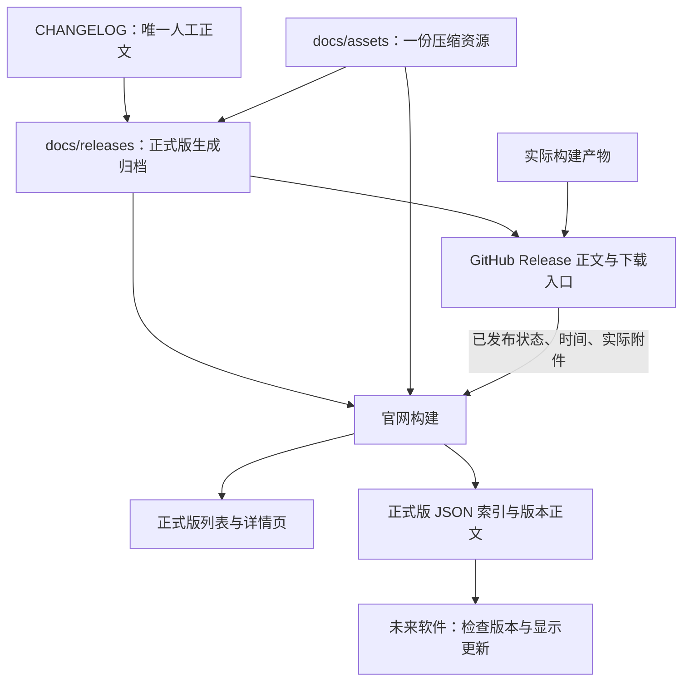

# 正式版本归档、官网与更新检测管线设计

> 设计基线：2026-10-17，HEAD `3fa96ed4`。2026-10-18 已完成首版本地实现与针对性验证，真实 CI / 发布 / 部署尚未执行；现行契约见[发布说明](../releases/README.md)，证据与边界见[实施记录](../logs/release1.9.0-beta.3/261018_正式版更新管线/IMPLEMENTATION.md)。

## 已确认的方向

- 只在根目录 CHANGELOG 的正式版条目中精修文字、配图与结构。生成的版本文档和网页均不另行编辑。
- `docs/releases/` 今后只归档正式版。beta / rc 继续留在 CHANGELOG；现有测试版打包与 GitHub prerelease 不因官网归档规则而取消。
- 配图在主仓库保存一份压缩原件，官网构建时复用，不为版本文档、官网与软件各存一份图片。
- 未来软件检测更新首版只提示正式版。本次设计预留数据出口，不实现自动更新或安装。

## 一、总览与数据来源

正文沿单向管线流动；资源和发布事实作为独立输入参与最终展示。



“每步只读取前一步”适用于**正文**：官网不回头解析 CHANGELOG，软件不解析整份 CHANGELOG 或 GitHub 页面。生成器的只读一致性检查仍可同时读取 CL 和归档，用于发现遗漏重生成。

发布状态不能从正文推断：有版本文件、有日期、有 tag，都不等于已经成功发布。官网下载能力同样不能只按文件命名猜测。

| 信息 | 唯一来源 | 消费者与规则 |
| --- | --- | --- |
| 更新正文、配图引用、可选系列基础版本 | CHANGELOG 对应正式版条目 | 生成版本文档；下游不独立编辑 |
| 版本正文与来源信息 | `docs/releases/<版本>.md` | GitHub Release、官网与 JSON 正文 |
| 图片文件 | 现有 `docs/assets/`，允许复用既有公开 `assets/` 文件 | 只引用；网站构建复制到输出，不提交额外副本 |
| 已发布、草稿、测试版、实际发布时间 | GitHub Release 元数据 | 官网与更新索引过滤；不读取远端手改正文覆盖仓库 |
| 可下载平台、架构、附件 URL 和大小 | 实际上传且已核验的 Release 附件 | 显示真实下载能力，缺少平台时明确说明 |
| 最新正式版 | 通过资格检查的版本集合 | 按语义版本比较；不按文件名或发布时间字符串排序 |

不增加数据库、常驻发布服务或手工维护的第二份版本清单。发布事实在 CI 中获取，页面与 JSON 静态生成，沿用当前官网托管方式。

## 二、作者的实际工作流

1. 日常只维护 CHANGELOG 的未发布区或 beta 条目。
2. 准备正式版时，在 CL 中写完整的正式版总结，覆盖本轮 beta 的最终能力，删除重复、过时和内部调整描述，并加入配图。脚本不自动拼接 beta 历史。
3. 从该正式版条目生成 `docs/releases/<版本>.md`；本地预览官网与最终 GitHub Release 正文。调整时继续改 CL，再生成。
4. 校验正文、资源、版本号和打包入口，按维护者明确授权提交并发布。
5. 发布任务先准备草稿，上传并核验实际安装包，最后公开 Release。
6. 发布完成后显式触发官网构建；构建同时生成历史页面与更新 JSON。线上探测通过后才记录官网和索引已刷新。

因此，日常人工输入仍只有 CL 正文和图片文件。发布命令、CI 和官网负责其余转换。

### 正式版与 beta 的边界

| 渠道 | CHANGELOG | `docs/releases/` 新归档 | 官网 Releases / 更新 JSON | GitHub 发布 |
| --- | --- | --- | --- | --- |
| 正式版，如 `2.0.0`、`2.0.1` | 保留精修正文 | 必须生成并校验 | 成功发布后收录 | 复用归档正文 |
| beta / rc 等预发布版 | 保留开发变化 | 不要求、不新增 | 不收录 | 保留现有测试版能力，从 CL 生成临时发布正文 |
| 未发布区 | 持续维护 | 不生成 | 不收录 | 不发布 |

原有 `1.9.0-beta.1.md`、`1.9.0-beta.2.md`、`1.9.0-beta.3.md` 已迁入 `docs/archived/release-notes/`，保留原文追溯。`docs/releases/` 只保存正式版本与管线 README。

## 三、目录与归档格式

沿用现有位置，下面的版本号只是结构示例，不表示真实发布：

```text
CHANGELOG.md
docs/
  assets/
    1.6.0/                         # 既有图片可直接复用
    2.0.0/                         # 新正式版必要配图
  releases/
    README.md                      # 生效后的发布契约
    2.0.0.md                       # 生成、入库
    2.0.1.md                       # 生成、入库
website/
  src/                             # 列表、详情、数据出口的模板和装配代码
  dist/                            # 网站及图片生成物，不入库
    releases/
      index.html
      index.json
      2.0.0/
        index.html
        notes.json
    docs-assets/                    # 按资源路径共用的构建输出
```

版本归档保留当前 Markdown + `maw-release` JSON 注释形式，避免为了网站更换整套格式。现有 `version`、`date`、`channel`、`base`、`source_sha256` 继续使用；后续如增加资源摘要或正文摘要，要定义兼容规则并更新 schema，消费者不依赖未声明字段。

归档保存本版本增量；`base` 保留现有的同系列正式 `X.Y.0` 引用能力。官网可将系列介绍折叠展示，软件可只显示本次变化，避免每个补丁版重复大段正文。基础版本也必须存在且满足公开展示资格。

根 CL 中的相对链接经过生成器转换后，归档在 GitHub 上也应能独立阅读。继续使用固定版本的仓库链接或明确的内容快照引用，不把历史图片指向浮动的 main。

## 四、配图复用与体积

### 一份源文件，多个引用

CL 引用现有图片路径，例如 `docs/assets/1.6.0/ass-style-library.webp`。生成版本文档只改写引用，不复制图片。官网构建识别本仓库图片引用，将需要的图片复制到公共资源输出，同一资源在文档和各版本页面间按来源路径去重。

新的 Release 页面不把图片或 Markdown 再复制、提交到 `website/public/` 或页面源码目录。现有使用指南同步脚本会提交图片副本，这是现状；首期不批量清理旧副本，但新管线不得继续引入同样的重复。构建器应尽量复用同一公共资源路径，并核对内容，避免两个同步器覆盖同路径的不同图片。

截至本次只读统计，`docs/assets/` 共 35 个文件，约 1.54 MiB。当前规模适合继续入库压缩图片；没有必要立刻增加图床、资源仓库或对象存储。

### 三种体积分别看

| 体积 | 处理方式 |
| --- | --- |
| Git 仓库和源码下载 | 原件只入库一次；反复替换图片仍会增加 Git 历史体积，引用去重不能消除这部分 |
| 官网部署产物和网络流量 | 构建时复制是必要的部署副本，图片跨页面共用 URL；合理尺寸、压缩、懒加载，避免内联 base64 |
| MAW 安装包 | 发布介绍和配图不默认打包；未来在线读取正文与图片。现有 Windows spec 未整目录收集 `docs/assets/`，其它平台在实施验收时检查 |

静态截图优先 WebP；UI 截图保持文字清晰，长演示不使用大 GIF 塞进主仓库。可先以单张约 300 KiB、单版本新增图片约 3 MiB 作为软提醒，超出时人工判断，不把此建议当作已经启用的硬门禁。

### 历史一致性与链接转换

- 图片发布后按不可变资源使用，更新图片用新文件名或新版本目录，不覆盖旧图。
- 官网本地化固定 tag / commit 的本仓库图片时，必须证明本地文件与归档指定版本的内容一致；可以读取对应 Git 对象，或对照生成时记录的资源摘要。不得只按同名路径拿 main 的图片。
- 缺少匹配资源时构建失败并指出文件；不悄悄替换为最新图，也不静默联网补齐未知来源。
- 既有外部图片链接可原样保留，标明其可用性不受本管线保证；不自动下载第三方图片入库。
- 发布前本地预览不能依赖尚未存在的 tag。预览器解析仓库资源，公开部署才校验固定引用。
- 图片渲染补齐替代文字、宽高和窄屏布局；逐步规范既有空 alt 或 `名称|600` 这类特殊写法，不能把它们误认为标准 Markdown 尺寸指令。

历史正文勘误时仍只改 CL 并重新生成归档；已发布 tag 不移动。若勘误涉及新图片，生成器须记录新的固定资源引用，而不是伪装为旧 tag 下已经存在的文件；具体 schema 在实施该能力时确定。

## 五、官网展示

### `/releases/`

仅列正式版本，按语义版本从新到旧排列。显示版本、CL 日期、正文开头的简短介绍或首个内容片段、详情入口；不要求再人工写一份摘要。首页导航增加“更新记录”。首版没有 beta 筛选器，因为这里不收录测试版。

### `/releases/<版本>/`

展示归档正文、配图、前后版本导航和 GitHub Release 入口。下载区读取实际附件，缺少平台产物时给出说明；正文不硬编码不存在的安装包。正式版的功能介绍与安装指引分开装配，共用同一正文即可，不要求官网与 GitHub 的完整页面逐字相同。

### 构建边界

- 沿用现有静态网站，不为 Release 页面引入独立后端。
- 路由、图片和 JSON URL 都遵循当前站点部署子路径，不能假设域名根目录就是项目根。
- 构建器只读取归档正文、资源和发布事实，不读 CL 来补缺失文档；缺失则明确报错。
- 发布前提供本地候选版本预览；生产构建始终过滤未公开版本，预览入口和预览数据不进入生产输出。
- 历史正文中的内部文档链接默认保留版本固定的 GitHub 目标，避免无意跳到已经变化的当前指南；可明确标注跳转现行官网指南的独立入口。

## 六、发布事实、CI 顺序与失败恢复

### 公开资格

一个版本进入生产网页和更新索引，至少需要：

1. 是合法正式语义版本，GitHub Release 同时满足非 draft、非 prerelease，不能只看其中一个标记。
2. 归档版本与 Release tag 对应，归档、基础正文和资源校验通过。
3. 发布流程要求的产物已上传并核验成功。保留现有 Windows 为门禁、macOS / Linux 可以部分成功的规则。

新发布流程先创建草稿，再上传和核验，最后改为公开。对于已经公开的历史版本，导入时也核对实际附件；不能仅因它们不是草稿就假定安装包齐全。

### 衔接当前 CI

现有 Pages workflow 按 main 文件变化部署，Release workflow 按 tag 打包，二者尚无完成后的显式联动。当前发布步骤会先创建公开 Release 再上传附件，存在正文已公开但上传未完成的窗口。实施需要改变这个顺序。

建议把“刷新官网”做成可重复执行的动作：发布任务完成后显式请求官网 workflow 在 main 上构建，并传递待确认的发布 tag。不要仅依赖普通 Release 事件自动触发另一个工作流；自动化凭据触发链和权限必须在实施时专项验证。只授予调用所需权限。

官网构建用当前模板与归档，发布事实从 GitHub Release API 一次性获取，分页读取正式版本并记录本次快照。线上不让每位访问者或每次软件启动直接调用 GitHub API。发布索引先校验 main 上归档与 CL 一致；若 tag 对应归档还未合入 main，构建失败并提示先补齐来源，不能退回直接解析远端正文。发布后的正文勘误以重新生成的 main 归档为准，GitHub 正文另行同步，不强制要求它与不可移动的 tag 中旧文本相同。

推 main、发布完成和手动重建共用同一套生成器。新索引不得因旧任务晚完成而回退；部署任务串行，并在获得执行机会后重新读取发布状态、使用最新 main。不要只靠取消前一个任务来保证顺序。

### 故障与恢复

| 情况 | 行为 |
| --- | --- |
| 打包或上传失败 | 不将新版本公开，不进更新索引；保留日志，可重跑 |
| Windows 成功、其它平台失败 | 允许按现行政策发布；只列实际存在的下载附件 |
| Release 成功、官网构建失败 | GitHub 版本继续可用，旧官网和旧索引继续服务；报告“已发布，官网待同步”，仅重跑网站步骤 |
| GitHub API 超时或无法分页完整读取 | 构建失败，保留上一份成功部署；不能把错误当作零个版本并发布空索引 |
| 正文或资源有勘误 | 改 CL、重生成、校验，按授权同步 GitHub Release 与官网；不移动旧 tag |
| 较老版本晚发布或重跑 | `latest_stable` 仍按语义版本选取，不按刚执行的 tag 覆盖 |
| Release 撤回或删除 | 重建时从公开索引移除；历史仓库归档保留，不要求强制客户端降级 |

完成后的外部验证分别检查 GitHub 发布状态、实际附件、官网详情 URL 和 JSON 目标版本；一次本地 build 成功不等于发布或部署成功。

## 七、未来软件如何复用

答案是可以，但软件应读取**由归档生成的稳定 JSON 接口**，不扫描 Markdown 目录或抓取网页 HTML。

建议先设计两个静态出口，具体字段在实施时以 schema 和夹具锁定：

| 地址 | 作用 |
| --- | --- |
| `/releases/index.json` | 小型正式版索引，判断是否有更新、哪些平台有包 |
| `/releases/<版本>/notes.json` | 用户展开时读取该版本正文和系列引用；图片转换为可直接访问的绝对站点 URL |

索引最小信息为：schema 版本、生成时间、最新正式版本，以及每版的版本号、实际发布时间、介绍页 URL、正文 JSON URL、GitHub Release URL 和实际下载附件列表。附件区分系统、架构、完整 / lite 变体，记录 URL 与文件大小。来源摘要可用于一致性追溯，不能当作代码签名或可信认证。

例如下面只表达字段关系，实施时生成真实 URL，不手工填写：

```text
schema_version
generated_at
latest_stable
releases[]
  version
  published_at
  notes_url
  notes_json_url
  github_url
  downloads[]: platform / arch / variant / url / size_bytes
```

未来客户端流程：

1. 按设置或用户手动操作请求索引；HTTPS、合理超时、缓存，联网失败不影响转写与编辑。
2. 用语义版本比较当前版本，排除相同、较旧和预发布版本。当前安装的是 beta 时也正确比较，如 `2.0.0-beta.2 < 2.0.0`。
3. 对跨过的多个正式版本显示版本列表，让用户选择查看；不只允许查看最新的一份。也可单独列出本机平台当前可下载的最高正式版本。
4. 首版提示新版本并提供“查看更新”和“下载”入口。若最新版本缺少当前平台附件，仍可查看说明，但不能误导为当前平台已有安装包；旧版本下载需明确标注。
5. 以后要内嵌正文时复用 `notes.json`；处理 Markdown / HTML 清理、链接策略、图片按需加载及图片失败的纯文本回退，不直接执行远端内容。

首期数据接口不承诺自动下载安装、静默升级、差量包、强制升级或任意远端命令。真正实现自动更新时再设计包校验、签名、安装事务和回滚。

## 八、历史迁移与实施拆分

### 阶段一：正式版内容契约

- 更新根规则、文档分类约定、发布 README 和生成器：只要求正式版归档，beta 发布仍有 CL 读取路径。
- 保留正式版正文与 CL 的一致性校验，不采用“生成初稿后单独精修归档”的模式。
- 明确资源引用、预览与生产转换规则，补充必要回归测试。
- 从已有 CL 补生成历史正式版，生产收录前匹配实际 GitHub Release 与附件。历史信息不完整时记录待核对，不伪造发布事实。
- 处理现有两份 beta 归档的迁移，确保 CI 不继续要求新的 beta 文档。

### 阶段二：官网历史页与资源共用

- 实现列表、详情和同源资源装配，接入导航与部署子路径。
- 先完成候选版本预览和公开资格过滤，再生成生产版本列表。
- 只构建需要的资源，新增副本不入库；其它文档同步的既有生成副本保持原流程。

### 阶段三：发布联动与更新数据

- 改为草稿准备、上传核验、公开、显式刷新网站。
- 从同一次发布事实快照生成 HTML、索引和按版本正文 JSON，统一筛选和排序规则。
- 验证发布失败、部分平台成功、重跑、老版本晚发布与官网部署失败的恢复路径。
- 检查线上页面和 JSON，再更新相应发布记录。

### 阶段四：软件更新提示

后续独立实现客户端的请求、版本比较、版本选择和展示。前面三个阶段无需等待客户端功能落地。

## 九、实施验收与尚待验证的细节

| 层次 | 验收重点 |
| --- | --- |
| 生成器单元 / 契约 | 正式 / beta 分流、重复版本和错误日期、CL 不一致、基础版本、资源缺失和资源错版 |
| 网站生成 | 版本排序、部署子路径、历史固定链接、去重资源、预览隔离、生产缺失归档时失败 |
| 发布资格与索引 | draft / prerelease / 无附件不误收录；分页完整；缺平台、旧版本晚发布、未知 schema 与撤回行为 |
| 真实浏览器 | 列表与详情导航、长正文、窄屏图片、图片失败回退、链接；布局截图与新增控件实测间距 |
| 打包 | 所有支持平台确认未意外包含完整发布图片和官网目录 |
| CI / 外部状态 | 发布末尾显式触发能力与最小权限、并发不回退、实际 URL 和目标版本一致、失败可只重跑部署 |

已核对本地脚本、归档、Windows spec 与两条 workflow。现有 Astro 网站是静态输出，适合承载这些页面和 JSON。框架文档查询本次遇到额度限制，在线文档抓取也未成功，因此未把特定 Astro API 或跨 workflow 触发语法当成已经验证的实现方案；编码时核对实际依赖版本并做最小构建与触发验证。

以上软体积预算、JSON schema、显式触发的具体实现属于实施细节；已确认的单一正文来源、正式版范围与单份资源原则不再悬而未决。
