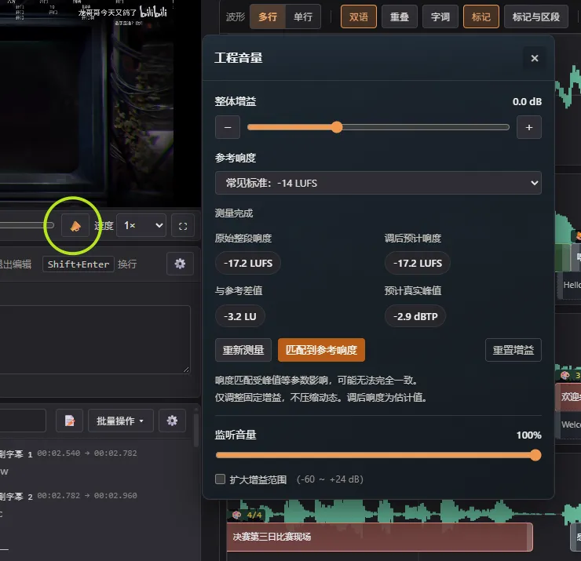
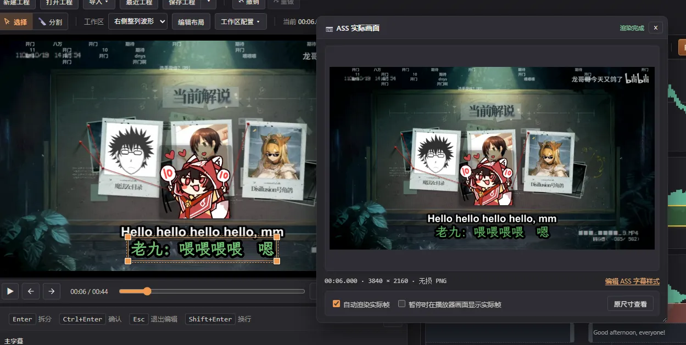
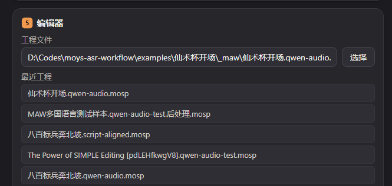
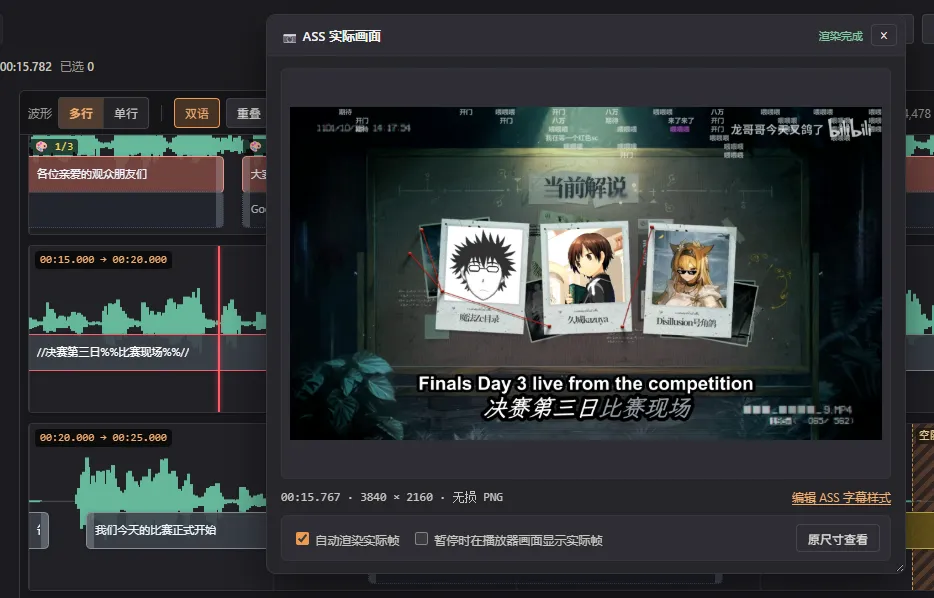
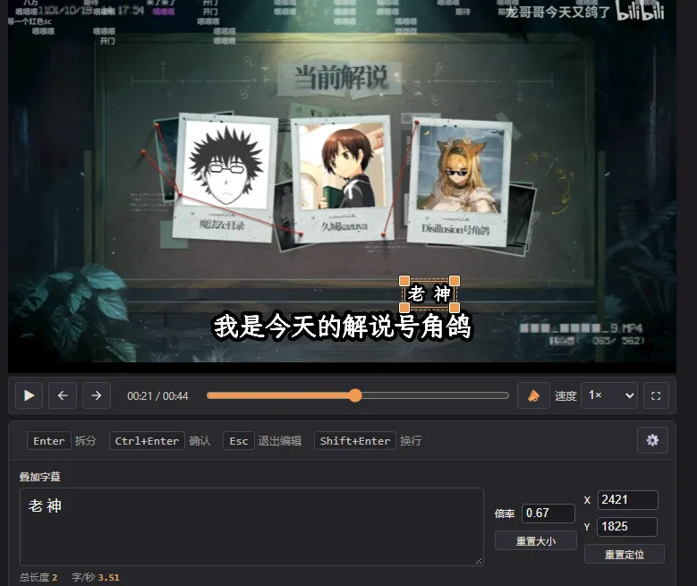
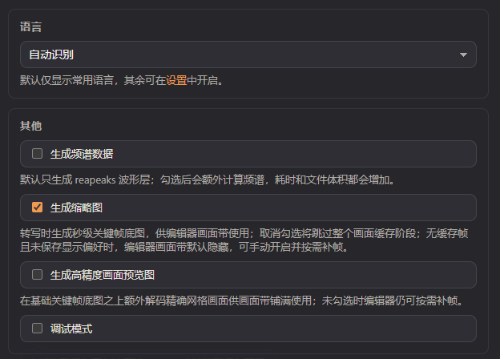

<!-- maw-release {"base": null, "channel": "stable", "date": "2026-11-04", "schema": "maw.release.v1", "source_sha256": "89b9caa36a53ea50601ae8f1851836ac5452b6c2841593b561ffd493842ad317", "version": "1.10.0"} -->

## [1.10.0] - 2026-11-04

1.10 集中提升了字幕交付与 Launcher 工作流：烧录字幕支持直接选择工程文件，**编辑器新增工程音量与响度**、**支持表情包烧录视频**、单句放大出现动画与叠加字幕逐句缩放。
启动器带来了**最近工程列表**、生成缩略图开关与更清晰的运行状态，并大幅缓解大工程编辑卡顿。

### 🚀 全新特性

- **工程音量与响度** ： 编辑器播放器新增 📣 响度弹窗，可测量媒体的 LUFS 响度并匹配到推荐（默认 −14 LUFS），原视频音量设置转为弹窗内的监听音量。同一工程增益应用于播放预览、整段烧录、去空隙烧录和带音轨绿幕视频，并随工程保存。匹配按真峰值余量限制增益，不添加压缩；监听音量只影响试听。

- **表情包烧录视频** ： 烧录视频会把当前工程的表情包与字幕一次性编码进视频，去空隙烧录按收缩时间轴同步显示。
	- 跟随「预览表情包」开关，关闭预览时同样不烧录。
	- 动图 GIF 循环播放、静态 WebP 正常烧录；动画 WebP 暂不支持。
	- 烧录位置可在设置中选「固定位置（与预览层一致）」或「字幕第一个字左侧」——后者按每句 ASS 字幕的实际位置逐句贴放，无法贴放时自动回退固定位置；SRT 烧录沿用固定位置，字幕与表情包均保留媒体时间轴。

- **启动器最近工程** ： 「编辑器」卡片直接展示本机最近打开的工程（最多 10 条，与编辑器共用记录），点击即填入路径并检查关联媒体；失效条目标记提示。打开启动器、编辑器加载完成和返回启动器时刷新列表。

### ✨ 提升

- **大工程编辑性能** ： 字幕量特别大时切换「显示字词时间码」不再白屏数秒（去除重复的全量重建与平滑滚动拖尾）；纯文本编辑逐条视图逐字修改不再卡顿（修改影响报告只重算被编辑的行，数千行工程单轮统计约从 130ms 降到 10ms）。

- **工具箱烧录支持工程文件** ： 烧录字幕可直接选择 `.mosp` 工程，按工程自身的基础样式（字体、字号、颜色、颜色字幕、叠加轨）临时导出 ASS 后烧录；强调语法、字级动画等完整 ASS 效果仍以编辑器导出 ASS 为准。

- **MASS 弱化格式改用 `%%` 并新增斜体样式** ： ASS 特殊文本样式的弱化文本从 `//文字//` 改为 `%%文字%% `，` //文字//` 改为表示斜体。旧工程中已用 `//` 标记的弱化文本会按新语法显示为斜体，不做自动迁移。

- **单句放大出现动画** ： ASS 模式新增句级标记 `{{文字}}`，该句以「从小放大落定到原字号」的入场动画出现（默认 0.7 倍、120ms，可在样式库「放大出现」中调整起点倍率、入场时长等参数），可与淡入淡出等样式按任意嵌套顺序组合。
	- 样式库同时把「淡入淡出」与「放大出现」的参数编辑和全局开关解耦：关闭开关后单句标记仍复用这些时长/倍率参数，开关只控制「每一句自动应用」。

- **ASS 叠加字幕单句缩放与定位** ： 叠加字幕支持逐句缩放，选中叠加字幕行可直接输入倍率；预览画布上可拖动叠加字幕固定位置，导出 ASS 时以 `\pos` 落盘。

- **实际画面叠加表情包** ： 「ASS 实际画面」对照窗在渲染帧上按当前时间叠加表情包图层，位置与大小和播放器预览层一致，跟随「预览表情包」开关，对照窗更接近完整成片效果；表情包叠在实际帧上方（素材与字幕位置不相交），成片烧录顺序不变。

- **启用表情包功能自动开启预览** ： 在全局设置打开「启用表情包」时会自动勾选预览设置里的「预览表情包」，省去手动到预览页打开一步；之后仍可单独关闭，重新打开应用后保持已保存的选择。

- **「生成缩略图」开关（默认勾选）** ： 启动器「高级选项」内新增「生成缩略图」开关，控制转写时是否生成关键帧底图画面缓存。「生成高精度画面预览图」开关只在「生成缩略图」勾选时显示，两者均可随识别预设保存/恢复。

- **AI 对比页改版** ： 口播整理、校对、断句与翻译生成的对比 / 译文核对页改用与 Launcher、编辑器一致的配色，正文字号加大；新增浅色 / 深色 / 自动主题切换并记住选择。标题直接显示处理类型（如「翻译成英文 · 双语合一」），统计数字可一键筛选，筛选栏滚动时保持可见，处理后一侧用绿底标出新增或改写的文字。

- **Launcher 运行状态** ： 运行环境版本落后时直接显示升级前后版本、依赖文件检测数和新版验证状态，操作按钮明确为「升级并验证运行环境」；对齐模型分别显示下载状态与实际缺失的运行依赖。

- **编辑器帮助与字幕烧录** ： 新增 ASS 样式、双语字幕、导出与烧录、标记与区段四页精简帮助及直达入口，当前文档与官网统一使用「双语字幕」。关闭 ASS 模式也可烧录视频或去空隙视频，使用样式库指定的 SRT 烧录样式，并保留进度和停止操作；左右添加字符保留单符号淡入淡出的位置，补齐已有单侧时不再重复符号。

### 🔄 变更

- **文稿工具入口** ： 将无需先转写的「文稿匹配」放入媒体工具、排在烧录字幕和口播对齐前；已有字幕的「文稿匹配」更名为「文稿修正」。字幕处理顺序为 AI 处理、OCR 去重、固定替换、文稿修正、生成时间码；媒体工具顺序为文稿匹配、烧录字幕、口播对齐、提取音频、生成波形。文稿修正顶部可直接跳转媒体工具入口。

- **源码目录与 ASR 入口** ： 文档、打包和测试配置归入对应目录，七个根目录转写脚本迁移为 `python -m maw.asr.<provider>` 模块命令，原有参数保留；Launcher 与 `MAW.exe` 用户入口不变。

### 🐛 修复

- **快速测试的画面缓存限长** ： 修复快速测试时仍为整段视频生成画面缓存、处理长视频耗时过长的问题。关键帧底图和高精度画面预览图只预先生成媒体开头 2 分钟。

- **本地模型自定义目录误判与串写** ： 修复把运行时 / 缓存根目录当成模型自定义目录时被误判为「已安装」的问题——现在会按引擎检查目录结构（Hugging Face 系要求 config.json，FunASR 系要求 config.yaml / configuration.json，FireRed 与合法自定义目录不受影响），不符合时明确提示「所选目录看起来不是该模型的模型目录（可能选了运行时/缓存根目录）」，并新增「清除自定义目录」按钮一键恢复自动扫描。

- **后处理供应商配置** ： 修复「口播整理」「AI 校对」等步骤测试连接成功后仍被拦截、重新勾选时重复弹出配置的问题，支持 LM Studio 等本地接口留空 API Key；设置默认显示该步骤的供应商，验证成功后绑定并启用步骤。关闭设置、取消勾选或切换供应商后，迟到的验证与刷新不会恢复旧选择；浏览器演示也保留各供应商的就绪状态。

- **本地文稿对齐** ： 修复 Windows 误把同名 Python 模块当作 FFmpeg 启动而导致字词时间码生成失败；工具箱新增「管理对齐模型」快捷入口，云端识别模式下也能独立配置运行环境、管理与下载对齐模型，并保留原识别设置。

- **波形与预览交互修复** ： 恢复字词时间码模式下字幕贴合接缝的两侧联动拖动（词块手柄保留独立命中）；修复播放跳过空隙时播放头僵在空隙结尾、需按两次空格恢复的问题；波形按 B / 右键拆分不再激活字幕列表的行内编辑框，不足 100ms 时按提示再次按 B 即强制拆分；暂停状态下撤销 / 重做后，播放器字幕画面与 ASS 实际画面预览立即更新。

- **启动器处理文件红字** ： 处理文件输入框的校验红字在拖入合法文件、清空或编辑文本、主页工程 / 媒体路径变化引发自动跟随等场景下立即清除，不再残留。

- **波形交互稳定性** ： 媒体缩略图高度不变时只刷新图片，避免状态刷新替换正在交互的波形节点；缩略图高度真正改变时仍保留当前滚动位置。

- **ASS 预览斜体边缘** ： 修复较大字号斜体字形超出排版宽度时，预览位图裁掉右侧笔画的问题；主字幕和副字幕均保留完整字形边缘。

- **编辑器英文提示** ： 补齐字幕入场动画和设置入口的英文说明，动态更新的悬停提示也会跟随界面语言。

- **HTTPS 证书安全** ： 更新主程序及 ASR/OCR/MOSS 运行环境的 certifi 与 urllib3，修复 eMudhra 中间 CA 私钥泄露后的信任问题和恶意流式响应异常分块导致的资源耗尽；开发与 CI 使用已修复的 Node/uv。

- **AI 整理本地复核不再误拦** ： AI 已建议删除且本地能证明安全时直接移除，不再降级为待复核：整段只剩「哎、嗯」等纯感叹词的片段自动放行；「重新开始、重新录」纳入流程用语佐证；下略。

- **英文口播整理** ： 修复英文词项自带空格导致原文无法对齐、反复重试仍失败的问题。

- **纯文本编辑字词时间码映射** ： 修复字词时间码与字幕文字存在空白 / 标点漂移时（例如英文词级时间码自带前后空格、AI 整理改写文字后未同步字词块），纯文本编辑里拆句、合并和逐句改写全部退化为「按范围估算时间」的问题；现在会先把字词块重新切齐到真实文字再映射，拆句边界落在空白上、开启「修改后移除字幕前后空格」等场景都能继续复用真实字词时间码，只有漂移过大无法可靠对应时才回退估算。

- **纯文本编辑搜索光标** ： 修复搜索定位到命中后看不到光标闪烁的问题；「上一条 / 下一条」和 Enter 会把焦点与选区移入命中所在的文本框，可直接继续编辑，并新增 F3 / Shift+F3 在编辑框内续跳；选区一旦离开命中（方向键、点击、输入），Enter 立即恢复普通换行，定位后直接拆句的流程不受影响。

- **ASS 字体名兼容与归一化** ： 修复实机画面与烧录对「得意黑（Smiley Sans）」等字体的静默回退——样式里存排版名（如 `Smiley Sans`）时渲染端无法识别，画面会悄悄换成默认字体且没有任何提示。现在实机画面、烧录与导出 ASS 前都会按本机字体表把字体名归一化成可识别的名字，字体被替换与「字体未安装」都会明确提示；ASS 样式的字体下拉改读本机字体别名表，直接显示并支持搜索中文名（如「得意黑」），手填英文名、旧工程存储值同样可用。

- **多句绑定表情包的预览区间** ： 一次给多句字幕分配同一个表情包时，预览初始只在第一句的时间范围内显示；现在分配后立即覆盖整个选区，无需拖动字幕条触发修正，旧版本落盘的工程重新打开时也会自动归一区间。

- **macOS 系统字体识别** ： 修复 macOS 27 起 PingFang SC、楷体等系统字体改为系统按需资产投递后，实机画面与烧录误报「字体未在本机找到」的问题——字体实际可用，该告警是误报；同时修复（各平台通用）多字重字体集合（TTC，如 Windows 的宋体、macOS 的苹方）只读取第一个 face（子字体）导致集合内其他字体名无法命中的问题。

- **浏览器本地视频的实际画面** ： 修复在编辑器里直接加载浏览器本地视频（未通过 Server 工程打开）时，暂停仍会叠出绿幕或服务器工程「实际画面」的问题；该场景与服务器工程无关，现在暂停叠加与对比浮窗都不再渲染无关画面。
