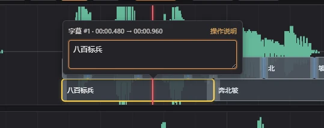
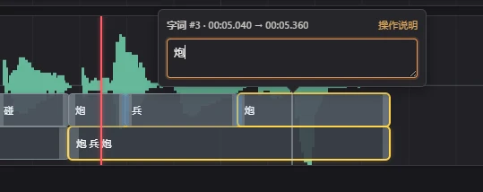
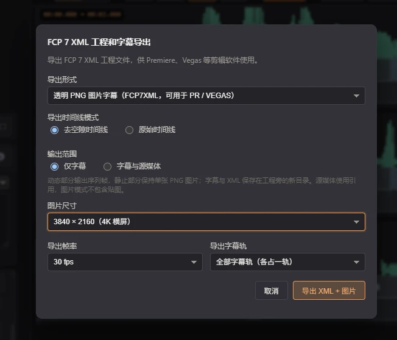
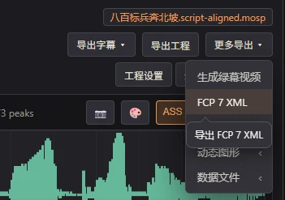
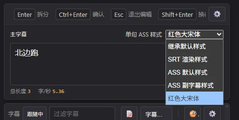
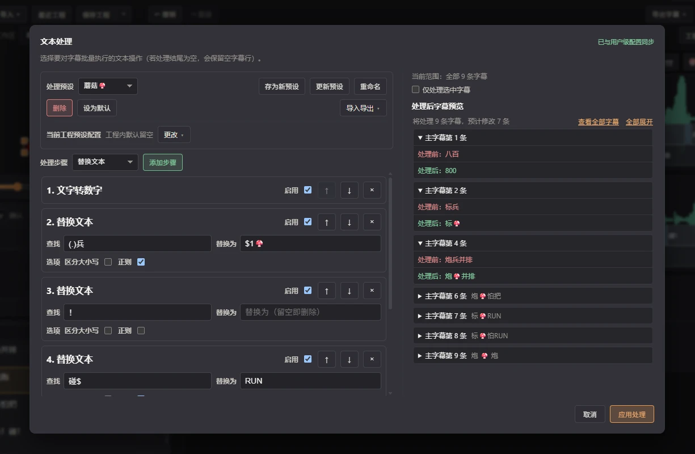

<!-- maw-release {"base": null, "channel": "stable", "date": "2026-11-09", "schema": "maw.release.v1", "source_sha256": "210b89a6c0271c5a3866eace27ed396846426216e3faab3deb9414dc4d0395dc", "version": "1.11.0"} -->

## [1.11.0] - 2026-11-09

该版本集中提升了**自动化出片** 与 **操作体验改善** ： 波形字幕块支持原位气泡快速编辑，新增图片格式的字幕导出选项（FCP7XML），新增了 CLI 的烧录字幕参数、编辑器的文本处理多步骤与预设，并且字幕可绑定单句 ASS 样式。

其他零碎改动：AI 自动移除的区段可快速恢复，修复第三方字体显示、慢盘烧录中断排查、空隙播放音头修正，etc。

### 🚀 全新特性

#### 快速编辑弹窗
**波形区字幕快速编辑** ： 双击波形区的字幕块即可在小弹窗中快速编辑字幕文本——不用再跑去看字幕编辑区啦！

**打开方式**
- 双击字幕、选中字幕后按 Enter，或者右键编辑字幕

- 字词时间码启用的情况下，同样可以双击编辑字词

**弹窗内的操作**
- 按 Enter 在光标处拆分（可在全局设置中交换拆分与保存按键）
- 默认拆分后继续编辑后半句；可在全局设置中关闭自动聚焦
- Shift+Enter 换行
- Tab / Shift+Tab 保存并切换前后字幕
- Esc 或点击窗口外关闭（并保留修改）

#### 导出透明图片格式的字幕+XML 工程

**透明图片字幕 XML（实验性）** ： 在右上角「更多导出」中，选择 FCP 7 XML 入口可导出用于 VEGAS 和 PREMIERE 等剪辑软件的 FCPXML 工程格式，并且支持将字幕渲染为透明底的 PNG/WEBP 图片格式，用于导入剪辑软件。

#### 单句字幕支持分配 ASS 样式
**单句 ASS 样式** ： 各字幕可选择单句 ASS 样式并随工程保存，这样一来，你可以给单句字幕单独设置颜色、字体等样式。

#### 跨工程可用的字幕处理预设
**字幕处理预设** ： 将原先的「文本处理」和「批量替换」合并为「字幕处理」按钮，支持配置多项操作，逐个执行，并预览最终的结果。

**预设管理**
- 预设支持跨工程复用，可分别导出单条预设和整库，便于分享。

### ✨ 提升

- **波形显示设置** ： 可关闭字幕块和字词块悬浮时的全文提示；视频缩略图补间开关移至模式选择旁，隐藏画面带时自动隐藏。
- **快捷编辑与帮助** ： 字词时间码模式下双击字词块编辑时不会误触播放；帮助页面调整了布局，并增加设置跳转入口。

- **CLI 烧录字幕** ： 公开 CLI 新增 `--burn` 参数，把 SRT/ASS/SSA 或 `.mosp `/` .json` 工程字幕直接烧录进 `-i` 视频，输出 `<原名>.压字幕.mp4 `（重名自动避让），与工具箱「烧录字幕」共用样式转换、字体归一化与编码器回退逻辑。自动化脚本无需再调用内部模块即可完成「转写 → 烧录」全流程。

- **Soniox 新模型 stt-async-v6** ： Soniox 于 2026-11-03 发布 v6 异步模型，官方称其为当前主力代且与 v5 接口完全兼容；Launcher 下拉框新增该项并设为默认，旧版 v5 保留为「旧版」选项。

- **AI 移除区段快速恢复** ： AI 口播整理自动移除的区段在标记弹窗和管理窗中显示「已移除／恢复」，恢复后显示「已恢复／移除」；用于快速调整 AI 判断的空隙区间。

### 🔄 变更

- **启动器的「生成缩略图」选项** ： 新增可选的「生成缩略图」开关，不需要缩略图时可关闭。选择纯音频文件时，自动禁用该选项。

- **视频预览区取消选择** ： 点击画面空白处会取消字幕/表情包调整框的选中状态。选区清空后，单击视频仍可播放或暂停。

- **表情包自定义背景** ： 全局设置中的表情包页新增「自定义表情包背景」开关（默认关闭）与背景颜色、不透明度设置。开启后，预览和烧录成片中的表情包将显示纯色背景。另外，取消了 ASS 预览中的半透明黑色背景。

### 🐛 修复

- **播放跳过空隙** ： 修复已移除区段在跳过前漏出音头的问题。

- **双语字幕预览** ： 暂停时开启或关闭双语字幕，播放器画面立即更新副字幕。

- **去空隙音频导出** ： 修复波形缓存末尾取整导致部分音频导出时误报保留区间超出实际时长的问题。

- **烧录视频导出在保存盘较慢时报「network error」** ： 烧录视频、重组后烧录与绿幕视频回传阶段的本地传输不再因浏览器写盘短暂停顿（慢速磁盘、杀毒软件实时扫描、同步目录）被服务端主动断开。同时，烧录命令真实失败时，服务端控制台与浏览器开发者控制台会输出有界的 ffmpeg 报错尾部，便于定位具体原因。

- **第三方字体名称显示和失效问题** ： 修复 ASS 字体下拉把「寒蝉活仿楷」显示成「寒蝉活仿楷__ Con」等乱码名的问题。

- **损坏视频卡在「正在校验和修复时间码」** ： 修复部分解码报错较多的视频（如损坏的 AV1 录制）转写完成后长时间卡住不动的问题。

- **表情包「字幕第一个字左侧」支持叠加字幕轨** ： 修复烧录位置选「字幕第一个字左侧」时，叠加字幕轨上的表情包不生效、始终落在固定位置的问题。

- **单行双语行的叠加字幕布局** ： 修复单行（基础）波形开启双语后，叠加字幕从 50% 线跳到主字幕格上方、字词条带压进主字幕块、全文预览气泡消失的问题。

- **Launcher 退出** ： 关闭窗口时立即停止推送后台事件，减少 WebView2 释放期间的异常与退出卡住。

### 🪒 工具

- **维护者 PR 看板** ： 新增本地开发工具 `tools/dev-dashboard`，在浏览器里聚合全部 open PR 的 CI 状态、可合并性与处理进度。

- **CHANGELOG 编辑器工作台** ： 改进操作体验。
