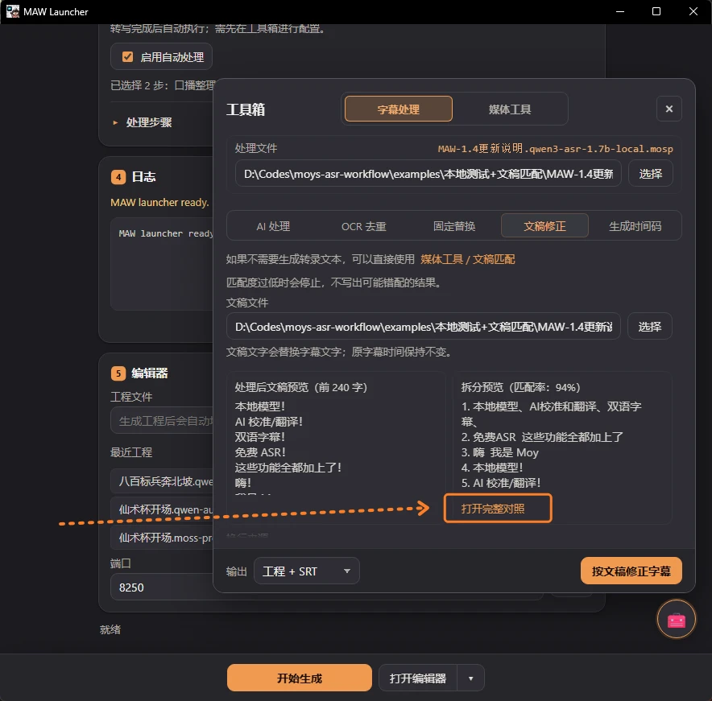
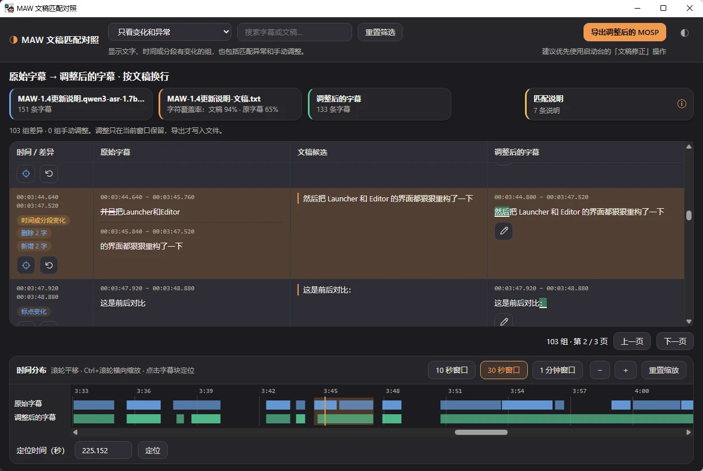
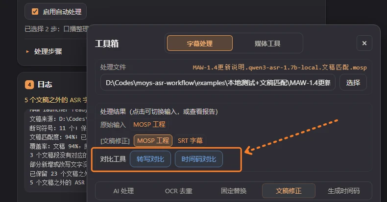
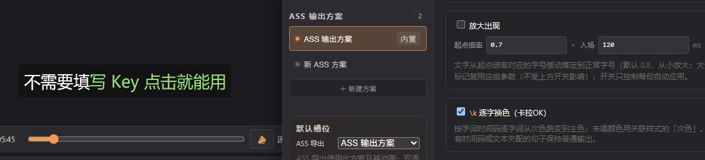
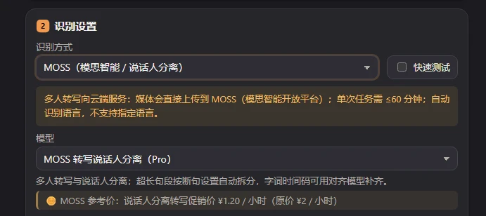

<!-- maw-release {"base": null, "channel": "stable", "date": "2026-11-23", "schema": "maw.release.v1", "source_sha256": "a90adb3815a3d80c66d9170f3c4a011d05193a0ad147e702598c2be633359101", "version": "1.12.0"} -->

## [1.12.0] - 2026-11-23

### 🚀 全新特性

- **🪒 文稿匹配对照工具** ： 史诗级更新！现在从启动器可以直接打开文包匹配（文稿修正）的完整对照，查看文稿候选、匹配说明和字幕改动详情，可改字、按组恢复原字幕并另存 MOSP。

- **🪒 对比工具**： 现在可以调用对比工具，快速查看 mosp 处理前后的字幕变化、对比不同模型/步骤的差异，以及查看时间码细节。

- **🎤️ MASSS 新动画：逐字换色字幕** ： 输出方案开启「`\k` 逐字换色（卡拉OK）」后，带字词时间码的主字幕按时间码逐字词从样式次色换到正常颜色。

- **☁️ MOSS 云端转写（模思智能）** ： 新增说话人分离云端供应商，多人转写带说话人标签，支持热词与自动识别语言，超长句段按断句设置拆分。

### ✨ 提升
- **ASS 样式库迁移** ： 支持导出、合并或恢复样式库，在不同电脑间复用样式与输出方案。
- **Launcher 拖放工程** ： 把单个 MOSP 拖到「选择媒体」时自动载入工程并转入「字幕处理」工具箱页面。
- **缩略图生成不再阻塞** ： 转写后可先打开工程，缩略图在后台补齐，不影响首次编辑。
- **编辑器烧录参数** ： 整段和去空隙烧录可在开工前选择画质、CPU 编码预设和音频码率。
- **副字幕逐句定位** ： ASS 模式下可拖动单条副字幕并手填 X/Y 固定位置。
- **文稿修正的说话人标签** ： 重新断句后按对齐文字继承占多数的说话人，不再按字幕顺序套用。
- **一键 GitHub Star** ： 从 Launcher「支持 MAW」或编辑器「设置 → 关于」为 MAW 一键加星。
- **DeepSeek 占位项提示** ： 谁能想到大肥鱼真的会更新 ASR 啊……但是它没有时间码所以还是没法用，但是提示文本也得相应更新了。

### 🔄 变更
- **启动器打开编辑器** ： 必须先选定工程；未选择时定位并高亮工程路径输入框。
- **启动器最近工程** ： 默认只显示最近 3 条，「显示更多」可展开完整列表（最多 10 条）。
- **口播对齐** ： 输入选项与按钮跟随界面语言；自动标记静音默认关闭，勾选后才显示参数。
- **文稿修正** ： Launcher 默认不勾选「清理 Markdown 符号」，已有配置保留原选择。
- **Faster-Whisper 自动设备回退范围** ： 只有确认缺失 CUDA/cuBLAS/cuDNN 运行库才自动改用 CPU；显存不足、模型损坏等其他错误直接报错。

### 🐛 修复
- **打开工程保留标点** ： 编辑器不再启动时隐式删除或替换中文逗号、句号，旧工程按原文打开和保存。
- **口播对齐** ：「从录音开始」自动生成输出路径，进度、取消和重试正常工作。
- **批量删除字幕** ： 右键可批量删除副字幕且保留主轨；Delete 只删除高亮选中的字幕，整批可一次撤销。
- **文稿匹配时间码** ： 使用「——」等多字符断句符时仍保留可靠的字词时间码。
- **运行环境升级** ： 减少安装进度密集更新时 Launcher 的界面卡顿。
- **AI 后处理双语工程** ： 修复主字幕合并或拆分后旧绑定导致处理失败的问题，并提示解除受影响的绑定。
- **去空隙视频烧录** ： 保留不落在整帧上的剪切时间，避免旧版 FFmpeg 丢尾帧或缩短无音轨视频，兼容 FFmpeg 5.1。
- **非零起点视频缩略图** ： 从 Matroska 尾部数据包核对真实结束时间，避免旧版 FFmpeg 少算一帧时长。
- **ASS 说话人底框** ： 修复名称与正文交界处的深色接缝，支持以引号等标点开头的字幕。
- **烧录体验和诊断** ：可原生选择保存位置并从完成提示打开视频或所在文件夹；失败时区分编码失败、下载中断和写盘失败，可直接查看或复制诊断。
- **Faster-Whisper GPU 转写** ： 自动设备遇到缺失 CUDA 运行库时改用 CPU 重试一次并提示；显式选择 CUDA 时保留原始错误与修复指引。
- **本地运行环境安装** ： 修复默认镜像缺依赖或文件校验失败时安装直接中断的问题，失败原因可在设置中查看。
- **默认保留断句标点** ： 新配置的转录、文稿匹配和手动拆分默认保留标点；已保存的删除规则继续生效。
- **文稿修正** ： 阻止错稿与低匹配度文稿写出结果，保留没有可靠对应的原字幕。
- **工具箱字词时间码** ： 校对原样合并字幕时保留可靠的字词时间码，重新断句支持零时长标点。
- **文稿换行的字词时间码** ： 完整匹配词保留原时间范围，句间停顿不再分给改写文字。
- **时间码对比** ： 按重叠时间区间对照拆句与合句，不再因增减字幕段整表错位。
