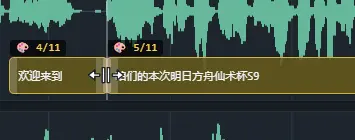
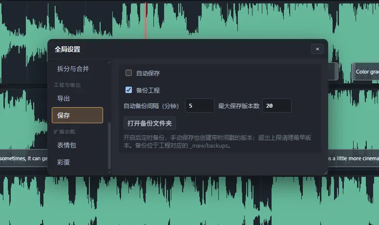

# MAWE 编辑器指南

MAWE 是 MAW 的字幕编辑器。日常使用本机 Server；便携 HTML 与在线页面用于浏览器中的兼容操作。它们共用前端代码与 `.mosp` / 旧 `.json` 工程格式。

源码启动见 [Server README](../../server-editor/README.md)，首次转写见 [工作流](WORKFLOW.md)。

## 1. 打开或新建工程

在 Launcher 中打开生成的工程，或从空白编辑器拖入工程、媒体、SRT。已有主字幕时导入第二条字幕，可以替换主轨或作为副轨。

「新建工程」通过浏览器保存对话框创建空白 `.mosp`。取消对话框不改变当前工程。不支持文件句柄的浏览器退化为下载，之后需手动导出保存。

空白工程拖入媒体或 SRT 时，会先创建工程再加载；只有字幕、没有媒体的工程也可以编辑与保存。没有媒体时不显示播放器和波形。

LRC 歌词可从打开菜单导入或拖入：每句持续到下一时间戳，空文本时间戳只作为结束边界，末句兜底 5 秒。`[offset:+n]` 整体提前 n 毫秒；增强 LRC 字词标签仅剥除，不生成字词时间码。

## 2. 播放、定位与修改文字

播放时高亮当前字幕，列表默认跟随播放头。手动滚动会暂停跟随，点击「跟随播放」恢复；编辑与撤销尽量保留阅读位置。

| 操作 | 用法 |
| --- | --- |
| 定位字幕 | 单击字幕行或波形块，跳到开始位置。 |
| 修改文字 | 双击文本；选中后按 Enter，在列表内联编辑或聚焦当前字幕面板。 |
| 播放 / 暂停 | 空格，或双击波形。 |
| 上一条 / 下一条 | A/W 与 D/S；Shift 扩展选择。 |
| 跳到字幕起点 / 终点 | I / O，保持暂停。 |
| 从选中字幕播放 | F。 |
| 新建字幕 | 波形空白处 N，或 Ctrl/Cmd 拖动指定时长。 |
| 切换波形工具 | V 选择、R 分割。 |
| 切换禁用 | Alt 点击字幕；禁用字幕默认不导出到 SRT。 |

列表与波形的文字输入、快捷键有各自焦点范围。内联编辑中 Shift+Enter 换行；Enter / Ctrl(Cmd)+Enter 的保存或拆分行为按编辑设置执行。当前字幕面板的 Esc 默认保留改动并退出，可在面板设置开启「Esc 放弃修改」。

列表可按文字筛选、隐藏禁用项；当前字幕面板显示长度、时长和阅读速度。「批量替换」先预览再确认，可撤销；非法正则不会修改数据。

### 视频缩略图导航

本机 Server 绑定视频并取得波形时间轴数据后，波形与字幕叠加区域上方默认以**关键帧标记**模式显示一条画面带，基础模式和多行模式共用时间坐标：每个关键帧的位置显示一帧画面，其余留白。点击画面带按鼠标位置定位并暂停，拖动可预览；开启帧吸附时沿用工程帧率，不会吸附到缩略图的采样点。

在波形设置的「视频缩略图」下拉中选择显示方案（选择会被记住）：**铺满画面带**整条铺满画面，缩放时自动调整密度，缺少的格子逐步补齐并实时解码精确画面；**关键帧标记**只在关键帧位置显示画面，不触发实时解码；**隐藏画面带**收起该区域。工程没有对应 `.mothumbs` 缓存时默认隐藏，手动选择后恢复。画面带增加独立的 48px 高度；单行布局会为画面带预留空间，保持字幕块可见。

「实时生成补间」开关仅在铺满模式下生效：默认开启，为当前视图实时解码精确画面；关闭后只读取并显示已有缓存画面（关键帧底图与已完成的精确格），不触发解码。关键帧标记模式不参与实时解码。

正常加载缺少波形缓存时，Server 会自动抽取波形；已有 ReaPeaks 波形也可兜底。波形完全不可用或明确跳过且没有载荷时，现有时间轴及画面带均不显示；首版不提供无音轨视频的独立画面时间轴。

播放期间暂停补帧解码，已有图片继续显示；暂停播放后按当前可见区域恢复。若同一视频的 Launcher 基础缓存尚未完成，也会暂停这部分画面生成，释放播放租约后继续；转写主任务不受这项控制影响。

纯音频、空工程、缺少解码工具或尚未建立 Server 媒体绑定时，画面带自动隐藏。浏览器单独选择 File 会清除旧视频的画面；待 Server 接管媒体后再使用画面缓存。便携 HTML 与在线空壳不会自动读取本地 sidecar，首版在这些场景正常隐藏。

画面带缺失时，可先查看波形设置中「视频缩略图」旁的状态：「视频缩略图已隐藏」表示当前浏览器地址保存了关闭偏好；「当前媒体没有可用画面」表示没有可用视频流；「画面缓存暂不可用」表示探测或缓存任务失败；「从本机 Server 加载视频后可用」表示页面尚未绑定 Server 媒体。Launcher 和独立 Server 使用不同端口时，显示偏好分别保存。基础缓存未完成时先显示已有画面并逐步补齐，后续重开仍可复用已经写入的缓存。

### 批量处理文字

工具栏的 📝「纯文本编辑」可编辑主字幕或当前副字幕，支持逐条和整体视图。顶部查找支持大小写与正则，Enter / Shift+Enter 循环定位；Ctrl/Cmd+H 展开替换。替换结果先保留在草稿中，点击「应用修改」后整批生效并可撤销，取消或关闭窗口会确认是否放弃草稿。界面语言切换不改变字幕原文和查找高亮。

编辑视图随工程保存，重新打开工程时恢复；当前字幕含换行而暂不能使用整体视图时，临时显示逐条视图，不覆盖已保存的偏好。查找框可用内置清除按钮清空；展开替换后，Tab 从查找直接进入替换输入框，Shift+Tab 返回查找。逐条编辑的修改前后对比显示在文本右侧，窄窗口下自动换到下方；时间范围未变化时不重复显示。

「批量替换」与纯文本编辑共用查找规则。正则替换支持 `$1`、`$01` 和 `$<名称>` 等标准捕获组引用；未启用正则时，替换内容原样插入。

选中一条或多条主字幕，右键「左右添加字符」（顶层菜单行，位于「高级操作」上方），可一次插入强调、放大、弱化、缩小、斜体、删除线、下划线、淡出淡入、原地震动、放大出现、音符等；「自定义」分别填写左右字符，也可只填写一侧。淡出淡入、原地震动与放大出现是整句效果（菜单里缀「整句」标记），始终包裹在已有符号最外层；其余样式包裹在已有外层之内再包正文。预设已包裹过的字幕不会重复添加相同符号，操作可撤销。

「文本处理（批量）」提供同组预设，可同时选择多个样式和自定义字符：按选择顺序从外到内嵌套，再次点击可取消选择；句级样式（淡出淡入、原地震动、放大出现）恒包裹在最外层。可先展开预览，再应用到选中字幕或全部主字幕；调整操作选项和处理范围时保留预览的展开状态。插入的是实际文字；ASS 中的格式和动画如何解析、SRT 如何处理这些标记，见 [ASS 特殊文本格式](ASS_STYLES.md#特殊文本格式)。这类成对标记语法统称 MASS（Markdown-ASS）。

「数字转换」把明确的中文数字转为带左右空格的阿拉伯数字，如「一百八十六」→「 186 」、「二〇二六」→「 2026 」。约数、惯用语、分数和有多种解释的口语缩略尽量保留，例如「三两分钟」「八九不离十」「三分之一」「一百八」。预览后确认实际文本，再应用；数字转换不重新对齐音频。

### 工程音量与响度

播放器的 📣 按钮打开可拖动的非模态音量窗口，窗口保持可见时仍可播放、暂停或定位媒体。工程增益滑块通常显示 −6 到 +12 dB，勾选底部「扩大增益范围」后显示 −60 到 +24 dB；已保存或匹配得到的范围外增益会自动展开，并提示当前值超出常规范围，回到常规值后才允许收起，避免暗中改动增益。加减按钮每次调整 1 dB，重置回到 0 dB。增益实时应用于预览，并用于整段烧录、去空隙烧录和带音轨的绿幕视频；参数随 `.mosp` 保存，支持撤销和重做。「监听音量」显示百分比，只改变试听大小。

从启动器打开关联媒体的工程后，展开面板会按需测量预览音轨的整段 LUFS 和真峰值；结果缓存复用，也可重新测量。显示的调后 LUFS 和真峰值为固定增益下的预计值。quapeaks 的 RMS 仍用于波形显示，不充当 LUFS 测量。浏览器导入的本地媒体支持增益预览，LUFS 测量需服务器绑定的媒体。

参考响度默认 −14 LUFS，可选择「常见标准：−14 LUFS」「播客：−16 LUFS」「广播电视：−23 LUFS」，或自定义 −70 到 0 LUFS 的参考值；工程中已保存的参考不会因默认值变化而重置。选择后点击「匹配到参考值」可一次计算固定增益。EBU R128 的参考为 −23 LUFS；−16/−14 LUFS 是常见参考，不代表所有平台的通用标准。自动匹配按 −1 dBTP 的峰值余量限制增益，无法达到目标时会说明原因；手动增益超出该参考会提示。此功能不添加压缩、限幅或频段均衡。

普通与去空隙烧录对保留的所有音轨应用同一增益，响度参考来自预览音轨。去空隙和 AAC 编码后的成片响度可能与预计值不同，其他音轨也不因此自动符合参考。导出的 SRT/ASS 字幕文件不携带音频增益。

### JKL 播放

在「全局设置 → 播放预览 → 播放控制」中开启 JKL 模式后，默认 J 倒放、L 正放，依次使用 1×、2×、4×、8×、16×；K 停止并重置 1×，再次 K 以 1× 播放。倒放只驱动时间轴，不播放反向声音。也可改用旧的「慢速和倍速」模式。

「播放过程中点击鼠标自动暂停」可让鼠标定位后暂停；关闭时保持原播放状态。

### 设置入口与生效范围

工具栏的「工程设置」位于「全局设置」左侧。工程设置随 `.mosp` 保存；全局设置中的个人偏好在本机复用。两个窗口独立打开和关闭，Esc 关闭当前最上层浮窗。

| 入口 | 内容 |
| --- | --- |
| 工程设置 → 时间与语言 | 时间单位 / FPS、主副字幕语言类型。 |
| 工程设置 → 字幕轨道 | 显示字词时间码、显示标记轨道、允许字幕重叠；字词码的行高和每行长度。 |
| 工程设置 → 双语字幕 | 双语字幕开关、字幕列表显示方式、自动适配高度、联动与字幕管理。 |
| 工程设置 → 字幕样式 | ASS 模式、主副字幕字体、颜色和背景；ASS 样式库仍供本机工程复用。 |
| 工程设置 → 颜色与说话人 | 工程颜色呈现、说话人映射、导出带上说话人。 |
| 工程设置 → 表情包 | 工程覆盖目录；清空覆盖后使用默认文件夹。 |
| 全局设置 → 通用编辑 | 选择、定位（含快捷键时间基准）、拖动。拖动指针始终启用。 |
| 全局设置 → 高级编辑 | 按键微调、静音空隙、对齐到帧、帧分隔符、特殊文本。 |
| 全局设置 → 播放预览 | 预览、播放控制，含「跳过静音空隙」。跳过状态随工程的空隙数据保存。 |
| 全局设置 → 字幕导出 / 更多导出 | SRT / ASS 输出选项；OTIO 与格式专用导出配置。 |
| 全局设置 → 调色板 / 表情包 | 本机色板与默认文件夹。 |
| 全局设置 → 功能区 | 波形区、编辑区、字幕列表的局部设置入口。打开局部面板时保留全局窗口。 |

波形区 ⚙️ 保留「波形外观」「显示」两组。工作区配置继续使用工具栏原入口。双语未启用时，功能区卡片会说明并禁用其打开按钮。

表情包目录可直接填写并读取，Server 验证成功后应用；失败时保留原有效目录与素材。工程覆盖优先于全局默认，默认路径不会被写入工程。便携编辑器可保存目录配置，读取本地图片需使用 Server。

旧工程未记录 ASS 模式和导出说话人名称时，两项默认关闭，不继承浏览器里另一工程的旧开关。语言类型未指定时继续按字幕文字判断。

## 3. 调整时间、拆分与合并

拖动波形块整体移动字幕，拖两端改变起止时间。默认「中缝联动」模式下，相接字幕之间的中缝同时调整两侧；单独拖某一侧手柄只改该字幕。

*中缝联动示例（1.6.0）：拖公共中缝同时改变前句终点和后句起点。*

传统边界模式与键盘调整仍受「自动吸附调整相邻字幕」控制，Alt 临时反转传统联动行为。完整时间微调规则见 [按键调整](KEYBOARD_ADJUSTMENT.md)。

### 字词时间码

在波形区 ⚙️ 设置的「显示」组中开启「字词时间码」，可在基础或多行波形上查看主轨已有 `items`。字词块内仅显示文字；完整文字和时间范围可通过悬浮提示查看。低行高或双语布局中整句块淡化为背景。开关只在当前会话生效，打开另一工程后关闭，副轨与叠加轨仍按整句编辑。

工程设置的「双语字幕」页可开启双语字幕，调整字幕列表显示方式和自动适配高度；「字幕轨道」页的「字词码」组可设置自动适配高度（默认 168 px）与每行长度。开启相应模式时仅将小于预设的值增大，已有更大的值保持不变；双语与字词同时启用时满足两者的高度下限，全部关闭后恢复原值。单行波形与高度足够的多行波形将字词块放在整句块上方，整句仍可拖动和调整边界。

单击选中，Ctrl/Cmd 点击切换多选，Shift 点击选择同句范围；拖动字词块移动，拖动两端调整边界。相邻块沿用字幕的传统联动或中缝规则，Alt 临时反转联动。选中连续块后按 C，或使用字词右键菜单合并。所有调整限定在句内，不改整句文字、范围或副字幕绑定；Esc 取消拖动，撤销/重做恢复字词数据。

一个 item 可能包含多个共享时间的字词。例如「喜欢」改为「很喜欢」后，新增的「很」可能共用旧 item 范围，而不是获得独立时间码。标点和空白挂靠相邻块，不独立占时间。缺少时间码的位置不自动补建；字词文字仍通过整句编辑修改。

部分文字缺码时，能唯一对应原文的已有字词仍会带上标点和空白；重复文字造成对应歧义时保留 item 自身文字，完整原文始终保留在整句背景中。

低频转换入口在主字幕右键的「高级操作 → 字词拆成字幕…」。确认窗列出可转换数量、缺码/无法对应等跳过原因及将解除的副字幕绑定。转换保留原文和标点，每个有效块生成一条字幕并保留单个 item；副字幕内容与时间保留。新增文字没有重新对齐音频，转换可能产生很短的字幕和更多空隙。整批可撤销，没有反向转换工具；已与单 item 一致的字幕不会重复转换。

### 拆分

B 按指针区域决定切点：在已选字幕行按文字位置，在波形按音频位置，其他区域按播放头。右键菜单也提供拆分。主字幕有可用字词时间码且开启自动时间码拆分时，可以直接按字词边界拆分；无 `items` 时只能估算切点。

| 拆分方式 | 快捷键 | `一二\|三` 的结果 |
| --- | --- | --- |
| 普通拆分 | B | `一二` / `三` |
| 渐进拆分 | Shift+B | `一二` / `一二三` |
| 复制拆分 | Ctrl/Cmd+Shift+B | `一二三` / `一二三` |

右键菜单按住 Shift 时「拆分」变为「渐进拆分」，再按住 Ctrl/Cmd 则变为「复制拆分」。两种特殊模式应用于主字幕，时间切点仍按普通拆分确定；绑定副轨按原联动规则拆分。渐进拆分保留前半句可用的字词时间码，清除后半句失配的时间码；复制拆分两侧均清除，避免复制文字与旧时间码错配。操作可撤销。

拆分弹窗中 Tab 切主副轨焦点，方向键/WASD 移动切点，空格锁定或解锁；时间码锚定的主轨不可手动移动。联动拆分时，副轨不能合法拆分不会阻止合法的主轨拆分，会解除绑定并提示；可钳制的情况按弹窗提示二次确认。

### 合并与吸附

选中连续字幕后按 C 合并；Ctrl/Cmd+Shift+A/D 可与前/后字幕粘合。同组颜色或表情包可以继承，混合选区不会错误继承。

「拼合字幕」批量处理短间隔或短字幕：默认间隔上限 200ms、短句上限 3，支持前后吸附与合并方向。禁用项和不同说话人的字幕不会合并。操作可撤销。

## 4. 多轨、标记与空隙

### 双语字幕与叠加字幕

导入第二条字幕后可开启双语字幕，选择主轨、副轨或双列显示。G 绑定、Shift+G 解绑、H 对齐，B 拆分；绑定默认同步一次时长，设置可关闭。主副轨联动、跨轨吸附、语言类型和冲突处理见 [双语字幕规范](MULTI_SUBTITLE.md)。

也可先开启「双语字幕」使用空副轨：导入询问选「否」仍启用；在副轨空白处右键「创建副字幕」、按 N 或 Ctrl/Cmd 拖动添加。双语设置中的「导入副字幕」可替换已有副轨，替换前需预览确认。关闭双语模式保留内容，重新开启、撤销与保存重开都保留副轨数据。

开启叠加轨后，可在主轨已有字幕的时间段创建另一条字幕；同一叠加轨内部仍不能重叠。主、副与叠加字幕的 ASS 呈现见 [ASS 样式](ASS_STYLES.md)。

### 标记与区段

「标记与区段」用于记录单点或时间范围的名称、备注和复核状态。AI 整理产生的待复核项在这里确认；字幕、标记与媒体剪辑决定分别保存，不应把提示标记当成已经完成的人工复核。

「定位试听」对单点标记从该位置继续播放，对区段标记只播放起点到终点并自动暂停；点击列表项或波形标记仍只定位。

### 检测和移除空隙

空隙检测根据波形扫描静音，可设置最小长度、阈值、滞回和前后保留量。移除只保存可撤销的 `gap_remove` 决定，不剪原视频、不改原字幕时间；播放和导出使用压缩时间线。波形区 ⚙️ 设置「播放」组中的「播放时跳过空隙」控制播放是否跳过已移除的范围。

橙色斜纹表示移除，灰蓝斜纹表示保留。Alt 点击切换，右键或 Alt 拖动添加范围；左键拖动整体移动，Ctrl/Cmd 拖动复制，边界/中键调整按空隙设置开启。进一步收缩会在现有结果上再执行一次收缩，重复点击继续收缩，可撤销。

「禁用空隙内字幕」默认同时要求覆盖至少 80% 且未覆盖部分不超过 300ms，再批量禁用主字幕；不改原时间。按来源恢复和技术语义见 [空隙来源](../engineering/GAP_PROVENANCE.md)。

## 5. 保存、另存为与备份

保存方式由当前工程的绑定决定：

| 工程来源 | 保存方式 |
| --- | --- |
| Launcher / Server 打开的工程 | 原子写回原文件；另存为限当前目录内的 `.mosp` / `.json` 文件名。 |
| 浏览器新建且保留文件句柄 | 直接写回已授权文件，Server 不接管、不加入其最近列表。 |
| 普通导入、便携或下载回退 | 没有可写绑定时，使用导出工程下载；支持句柄时可通过另存为取得授权。 |

Ctrl/Cmd+S 保存，Ctrl/Cmd+Shift+S 另存为。浏览器新建时解除旧 Server 工程绑定，防止串写。Server 导入工程的接管条件见 [Server README](../../server-editor/README.md)。服务退出但页面仍开着时，可以导出工程保留改动。

自动保存按设置执行；文字提交还有短暂防抖保存。覆盖 Server 工程前保留 `.mosp.bak` 或 `.json.bak`，它是紧邻的上一个磁盘版本。

### 多版本备份

Server 的「全局设置 → 保存 → 备份工程」默认开启，默认每 5 分钟备份、保留 20 个版本；范围分别为 1–1440 分钟、1–1000 份。定时备份不覆盖原工程、不清除未保存标记，每次手动保存也创建版本。

*备份设置示例（1.6.0）：自动保存与多版本备份是两个独立开关；可从这里打开备份文件夹。*

工程旁使用 `_maw/备份`（英文 `backups`），已在 `_maw` 或 `<媒体名>_maw` 内则直接复用。版本文件为 `project-时间戳.mosp-bak`，重名加序号；超过上限的最旧备份移入回收站。

恢复时复制所需版本到原工程目录，将 `.mosp-bak` 改为 `.mosp` 再打开，以保持相对媒体引用。浏览器单文件句柄不授权旁边目录，不能管理此版本库；通过 Launcher 重新打开后可使用。

## 6. 预览、样式与工作区

普通 CSS 预览的字幕框可以拖动，用八个手柄缩放；方向键移动，Shift 加速，Alt+方向键改尺寸。几何保存在 `preview.subtitle`，不改字幕时间。ASS 模式由样式库接管位置，见 [ASS 样式](ASS_STYLES.md)。

颜色和表情包可从字幕右键分配，跨句引用会随拆分合并维护。表情包根目录由 `-s` 或 `STICKER_DIR` 指定。说话人显示按颜色映射名称，只影响预览；是否附加到导出字幕另行选择。

全局设置可以切换中文/English、主题和强调色。Server 的最近工程与工作区库保存在本机设置中：内置工作区可保存覆盖版、重置或另存为，自定义工作区可删除。便携 HTML 使用浏览器偏好及 `.workspace.json` 导入导出。

## 7. 选择导出格式

| 格式 | 用途与边界 |
| --- | --- |
| `.mosp` / `.json` | 继续编辑的完整工程；新工程优先 `.mosp`。 |
| SRT | 通用字幕；可按颜色拆分，也可将主轨第一句起点延长到 0。双语模式另提供副字幕与双语整合 SRT。 |
| ASS | 样式、说话人、主副与叠加字幕，见 [ASS 样式](ASS_STYLES.md)。 |
| TXT | 按字幕行输出纯文本。 |
| 去空隙 SRT / ASS | 与压缩时间线配套的字幕。 |
| 时间线 OTIO | 保留区间的媒体 clip，字幕及可选工程标记作为 marker。 |
| 去空隙重组后视频 | Server Editor 使用当前工程绑定的源视频和保留区间生成同容器视频，按保存位置选择器写入；音视频及其它流均以 stream copy 尝试保留。 |
| 去空隙重组后烧录视频 | 视频工程中在「去空隙导出」菜单提供：按保留区间重新编码并烧录当前字幕，输出 MP4。解码后按保留区间裁剪，视频精确到帧、音频精确到采样，并对齐收缩后的字幕时间轴。ASS 模式使用当前方案，关闭时按 SRT 烧录样式转换。 |
| 烧录字幕视频 | 工具栏「烧录视频」按钮要求已绑定视频工程：ASS 模式使用当前 ASS 方案，关闭时按样式库指定的 SRT 烧录样式转换当前 SRT，再烧录完整源视频。输出 MP4，硬件编码不可用时回退 CPU；进度窗口可停止任务。 |
| 绿幕视频 | 「更多导出 → 生成绿幕视频」：Server Editor 关联音频、视频工程均可使用，无需开启 ASS 预览模式。将当前 ASS 字幕渲染到 1080P、30 fps 绿幕画布，输出 MP4，时长到最后字幕结束后半秒；全局设置「更多导出 → 绿幕视频导出」提供「附带音轨」，默认关闭，开启后加入当前源媒体选定的音轨（源文件没有该音轨时保持静音）。该偏好保存在本机，不写入工程。 |
| 去空隙重组后音频 | 音频工程中显示「重组后音频」，使用当前选定音轨按保留区间导出 WAV，保持源采样率、声道及采样精度。 |
| FFconcat | 给外部 FFmpeg 工具读取的保留区间清单，需配套去空隙字幕。 |
| 保留区域 JSON / Resolve JSON | 给外部工具的交换数据，不是工程文件。 |
| 表情包 OTIO | 独立图片轨道时间线。 |

去空隙导出只在存在移除决定时出现。重组媒体需要以 Server Editor 打开并绑定音频或视频工程，以及支持保存位置选择和流式写入的浏览器；服务端只使用当前工程绑定的源媒体，不接收保存路径。保存位置选择期间切换工程、解除绑定，或音频工程更改音轨，会中止旧导出，请按新的选择重新导出。

视频在同一容器中 stream copy，保留区间起点向前、终点向后扩展到所有视频轨共同的安全关键帧边界；扩展后相交或相邻的区间合并，因此很短的静音空隙可能继续保留。服务端检查实际码流的独立解码入口，不能证明安全或诊断预算不足时保守保留对应区域，不把普通关键帧标记直接当作安全切点。

进度面板分别显示计划删除、实际删除和仍保留时长，并区分内部空隙与用户要求裁掉的头尾区域；未完全删除的区间会说明已确认的原因。「累积偏移时长」独立表示合并后的实际保留总时长减去原保留总时长，不是字幕整体平移量，也不能代替内部空隙未删时长。实际文件仍可能有帧或音频包级差异。没有任何区域能够安全删除时不写入完整源视频副本，面板明确显示未生成视频。开放 GOP 的完整裁切仍不在本次支持范围。

目前可证明的入口以 H.264/H.265 的 IDR 为限，并需能核对容器内真实包位置；这不等于 MP4、MKV、TS 的所有素材均受支持。较大的 TS 关键包如果超过单点 64 KiB 诊断读取预算，会以信息不足处理并保守保留对应区域，而不会将它误判为安全或直接断言编码不支持。带未支持包变换的 MKV、无法确认包边界的素材以及耗尽诊断预算的情况也可能无法裁切。

服务端顺序读取源文件，按各流的包边界保留内容并映射时间，核对媒体流签名与逐包时间线后才回传，不重编码。扫描和重组需要读取完整源媒体；仅保留长文件的很少部分时，也不会只读取选中片段。较多切点需要支持从文件加载选项的较新 FFmpeg，不支持时会提示更新。某些流与容器组合可能不受 FFmpeg 支持，不能保证逐毫秒精确。保存完成后，结果面板提供「保存匹配字幕（SRT）」和关闭按钮；这份字幕按本次实际视频时间线生成，原工程与已有精确去空隙字幕导出保持原义。「打开文件夹」暂未提供。

音频先完整解码，再按最近音频样本裁切和拼接，输出 WAV；切点不受视频关键帧或压缩音频包边界限制，时长按实际保留样本数计算。WAV 文件可能比压缩源文件更大。

OTIO marker 使用媒体源坐标；时间线导出的 WAV BWF 非零起点会保留。跨移除区的字幕按保留区间拆分，字幕颜色映射为 OTIO 命名色。媒体重组用法见 [工具箱](TOOLBOX.md)。

双语整合 SRT 按主、副轨各自边界切成不重叠条目；重叠时主字幕在上、副字幕在下，未匹配字幕单独保留，禁用项排除。副轨无可导出文字时，副字幕和整合选项灰显；关闭双语后隐藏。主字幕 SRT 继续包含启用的叠加轨；首句延长到 0 不移动副轨时间。

保留工程和原媒体，交付格式无法还原全部字词时间码、工作区或编辑决定。正式字段契约见 [JSON_SCHEMA](../engineering/JSON_SCHEMA.md)。
